

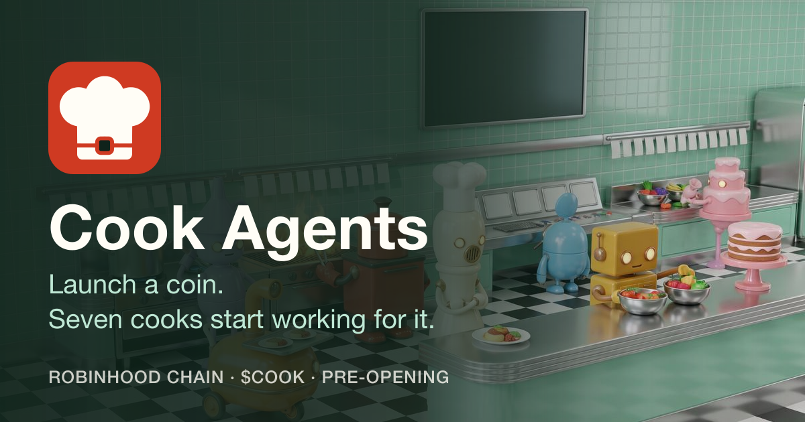

# Cook Agents

**Launch a coin. Seven cooks start working for it.**

A kitchen for new coins on Robinhood Chain, paid from each coin's own trading fees.
No trades, no bill.

[Website](https://cookagents.fun) · [Docs](https://cookagents.fun/docs) · [X](https://x.com/cookagents)

  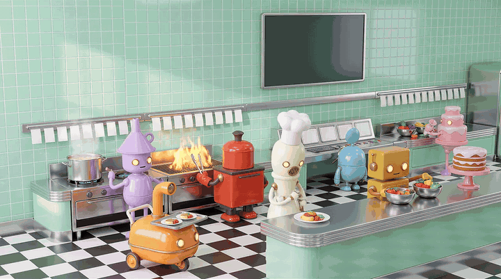

---

## About

Launching a coin is cheap. Feeding it is not.

On Robinhood Chain's launchpad, opening a coin takes one transaction and a **0.0005 ETH** fee, and roughly a thousand coins open there on a busy day. The work after the launch is a team's work: a picture worth keeping, a voice, a page, and something new to say every day. Most launches have one person.

Meanwhile, every trade already pays a creator fee. **70% of the launchpad's 1% curve fee** is credited to the coin's fee recipient, in ETH. On most coins that stream sits unclaimed, or gets sold with no plan behind it.

**Cook Agents points that stream at a kitchen.** A coin opened through the kitchen sends its creator fee to its own **Tab**, and seven AI cooks spend that tab on the coin's brand, its page and a fresh post every day. Part of every tab buys **$COOK** and burns it.

The bill only exists while people trade. A quiet coin costs nobody anything. A busy coin gets fed every day. And the dev stays the chef: **nothing is ever posted without them.**

  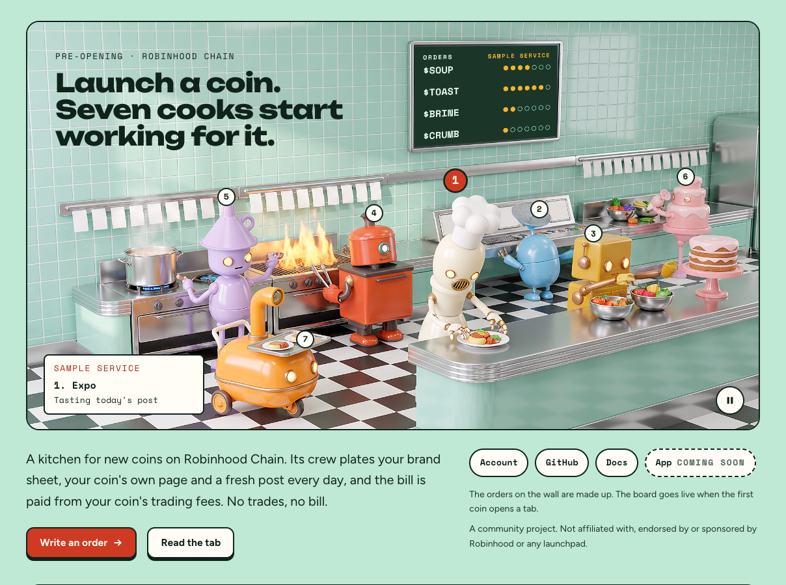

---

## Status

Cook Agents is in **pre-opening**. Here is exactly what exists today.

| Part | State |
|---|---|
| Landing page and docs | **Live** at [cookagents.fun](https://cookagents.fun) and [cookagents.fun/docs](https://cookagents.fun/docs) |
| Contracts (Kitchen, Tab, Burner) | Built. 75 unit, fuzz and invariant tests, plus 11 tests on a fork of Robinhood Chain against the launchpad as it runs on mainnet. **Not deployed** |
| App (Pass, Order, Window, Board) | Built. 217 of 217 end-to-end checks on the fork. **Not deployed** |
| Crew (seven stations, keeper, kitchen queue) | Built and proven on a demo coin. **Not running in production** |
| $COOK | **Not open.** Contracts first, token second |

> [!WARNING]
> $COOK does not exist yet. Another coin already uses the `COOK` ticker on Robinhood Chain and has nothing to do with this project. Our address will appear in the permit frame on cookagents.fun first, then on [@cookagents](https://x.com/cookagents). Nowhere else.

---

## Features

### 1. One order ticket, one signature

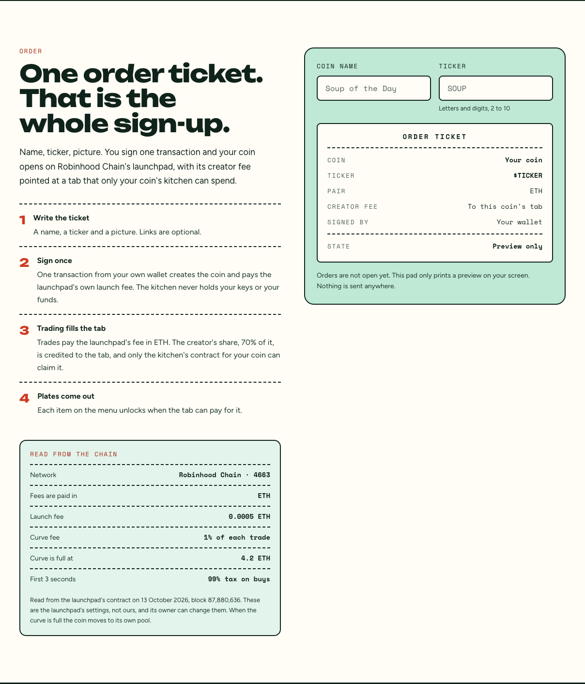

A chef (the dev) writes a ticket: a **name**, a **ticker** and a **picture**. A two-line story and links are optional.

One transaction from the chef's own wallet calls the **Kitchen** contract, which in the same call:

- opens the coin on Robinhood Chain's launchpad and pays its 0.0005 ETH launch fee
- deploys the coin's own **Tab** contract
- names that Tab as the coin's creator fee recipient
- runs an optional **first buy**, exempt from the launchpad's 3-second rush tax

The kitchen never holds the chef's keys or funds.

---

### 2. The Tab: every coin pays its own bill

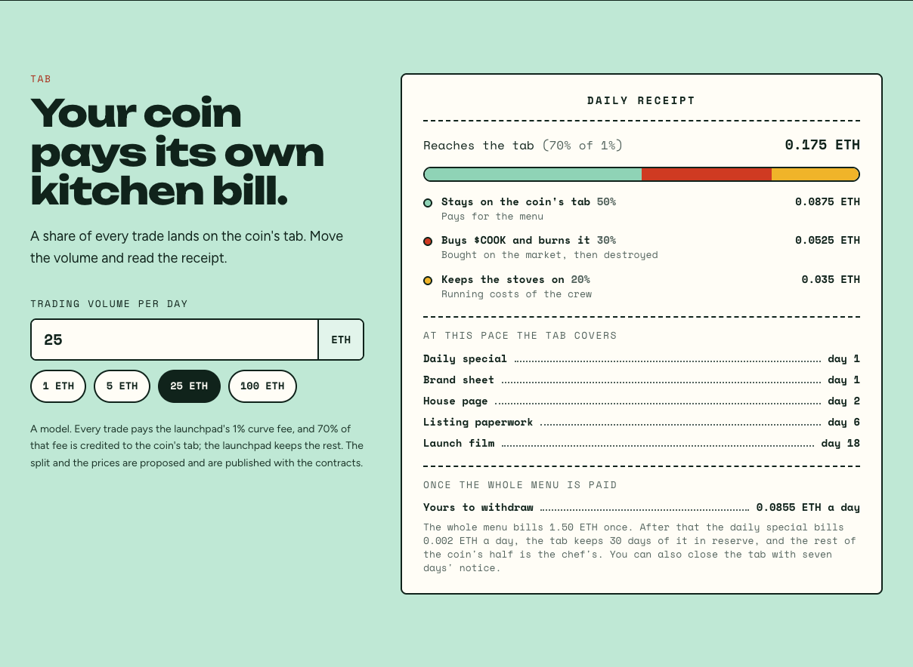

Each kitchen coin has exactly one Tab. Every trade credits it in ETH, and anyone can call `claim()` to pull the fees and split them in public.

**Per 1 ETH traded on a kitchen coin:**

| Where it goes | ETH | Share |
|---|---:|---|
| Curve fee | 0.0100 | 1% of the trade |
| Launchpad protocol share | 0.0030 | 30% of the fee |
| **Credited to the coin's Tab** | **0.0070** | 70% of the fee |
| └ Stays on the coin's tab, pays its menu | 0.0035 | 50% |
| └ Burner: buys $COOK and burns it | 0.0021 | 30% |
| └ Stove: keeps the crew running | 0.0014 | 20% |

Every claim, bill, burn and withdrawal is an on-chain event, readable by anyone on the chain's explorer.

---

### 3. A menu priced in fees, never in market cap

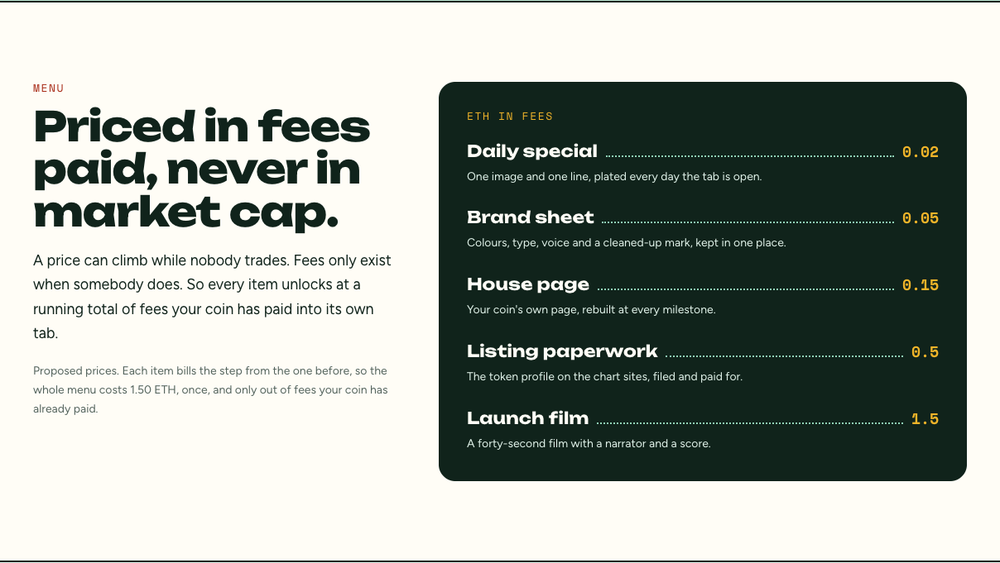

A price can climb while nobody trades. Fees only exist when somebody does. So every item unlocks at a **running total of fees** the coin has paid into its own tab.

| Item | Unlocks at (tab total) | Bill at unlock | What the coin gets |
|---|---:|---:|---|
| Daily special | 0.02 ETH | 0.02 ETH | One image and one line, every day the tab is open |
| Brand sheet | 0.05 ETH | 0.03 ETH | Colours, type, voice and a cleaned-up mark |
| House page | 0.15 ETH | 0.10 ETH | The coin's own page, rebuilt at every milestone |
| Listing paperwork | 0.50 ETH | 0.35 ETH | The token profile on the chart sites, filed and paid for |
| Launch film | 1.50 ETH | 1.00 ETH | A forty-second film with a narrator and a score |

- The **whole menu bills 1.50 ETH, once**, and only out of fees trades have already paid.
- After that the daily special bills **0.002 ETH a day**. The tab keeps 30 days of it in reserve and **everything above is the chef's to withdraw**.
- At 25 ETH of daily volume, the full menu is paid on **day 18**. From then on the chef can withdraw about **0.085 ETH a day**.

*Prices are proposals until the contracts are published. A later change applies only to coins opened after it.*

---

### 4. The brigade: seven stations, one coin at a time

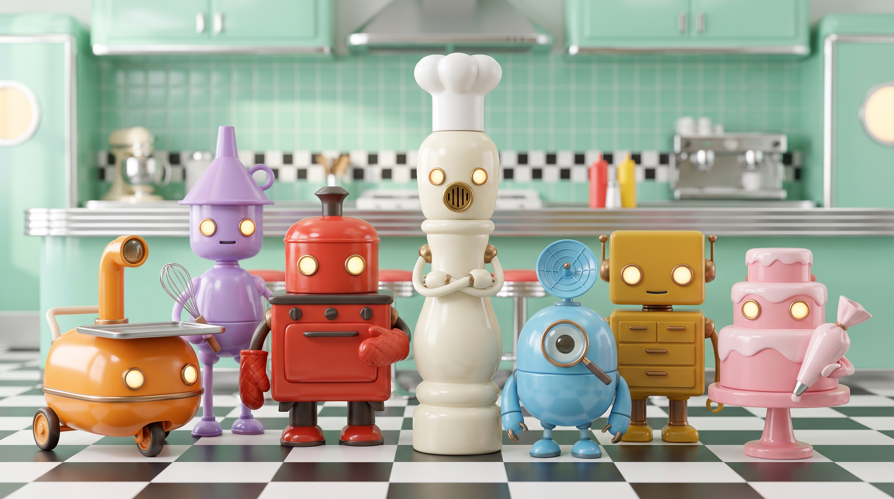

Each cook does one job and hands the plate on. Every morning the kitchen queue lists the coins whose menu allows a plate, orders them by service tier, and walks each coin through the stations.

<table>
  <tr>
    <td align="center" width="25%">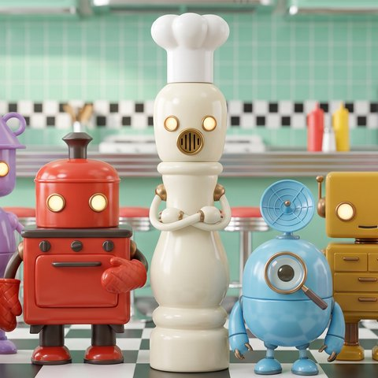 <b>Expo</b> Head of the window</td>
    <td align="center" width="25%"> <b>Scout</b> Reads the room</td>
    <td align="center" width="25%"> <b>Prep</b> Keeps the brand sheet</td>
    <td align="center" width="25%">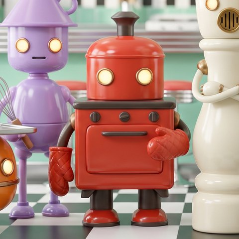 <b>Grill</b> Draws the image of the day</td>
  </tr>
  <tr>
    <td align="center">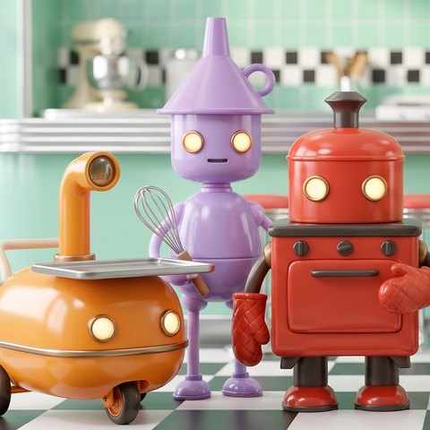 <b>Sauce</b> Writes the line</td>
    <td align="center"> <b>Pastry</b> Builds the coin's page</td>
    <td align="center"> <b>Runner</b> Carries it out</td>
    <td align="center"> <b>The chef</b> You. Serves every plate</td>
  </tr>
</table>

| Station | Job | Cooks |
|---|---|---|
| **Scout** | Reads the coin's market every morning (pairs, volume, trades) and files a note with the one thing the coin can honestly say today | Every morning |
| **Prep** | Studies the coin's picture and story, then keeps its colours, type and voice in one brand sheet | At opening, then weekly |
| **Grill** | Cooks one new image a day in the coin's own style | One a day |
| **Sauce** | Writes the line for each image, plus a second draft. Not a word about price | With every image |
| **Expo** | Tastes every plate. A made-up number or a promise about price sends it back to the stove | Every plate |
| **Pastry** | Bakes the coin its own page and adds a layer at every milestone | At opening, then at milestones |
| **Runner** | Brings finished plates to the window and files the listing paperwork once the tab can pay for it | As plates finish |

A plate that fails twice is dropped and logged. The chef sees the reason, never the failed plate.

---

### 5. The window: nothing leaves the kitchen on its own

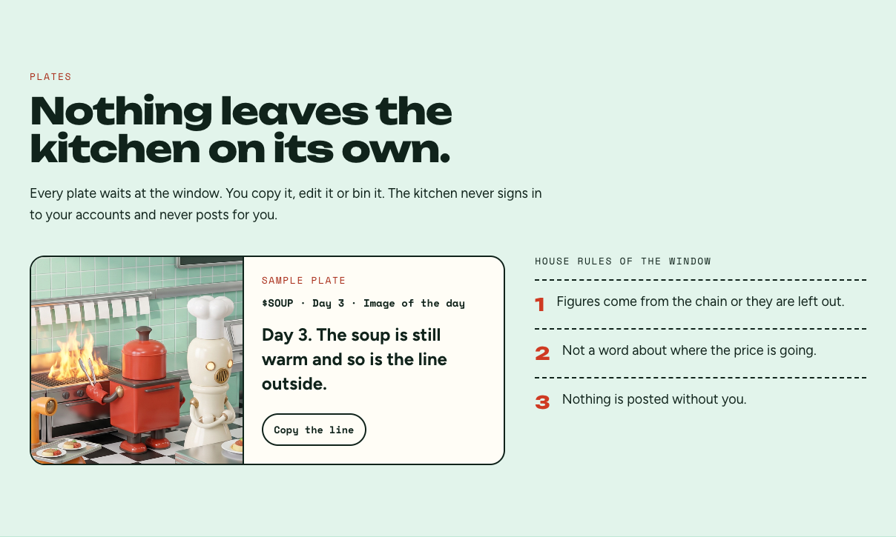

Every plate waits at the **window**. The chef copies it, edits it, downloads it or bins it, then posts it from their own account.

The kitchen **never signs in** to a chef's accounts and **never posts** for them. That keeps the chef's accounts on the right side of the platform's rules, and keeps one bad machine-made post from going out under their name.

**House rules of the window:**

1. Figures come from the chain or they are left out.
2. Not a word about where the price is going.
3. Nothing is posted without the chef.

---

### 6. Expo, proven on a real plate

Here is an actual run of the crew on a demo coin, **$SOUP (Soup of the Day)**, 15 October 2026.

<table>
  <tr>
    <td align="center" width="50%"> <b>The chef's picture</b>, from the order ticket</td>
    <td align="center" width="50%"> <b>Grill's image of the day</b>, same character, new scene</td>
  </tr>
</table>

> **The line, at the window:**
> *"Fresh veggies are flying today. Catching carrots and onions in my pot to simmer a warm bowl of $SOUP."*

What happened on the way there:

- **Scout** found that **three other coins already trade as SOUP** on Robinhood Chain, flagged them in the morning note, and used none of their figures. With no contract address for this coin yet, it told the crew to lean on the picture and the story instead of numbers.
- **Prep** pulled the brand palette straight from the coin's picture.
- **Expo sent the first draft back.** Sauce had written *"perfect"*: an empty superlative meant to excite buyers. The second draft passed.
- **The whole run cost about $0.23**, of which the daily plate itself (image, line and checks) is about **$0.18**. The image is most of it.

Expo can pass a plate or send it back. It cannot publish.

---

### 7. The board and the stars

The board is the kitchen's wall: every kitchen coin as a live order, public, no wallet needed.

- One card per coin: ticker, tab total, menu progress, stars, plates served this week, ETH burned for $COOK
- The kitchen's own health: the keeper's last run, the indexer's last block, the Burner's last batch
- Every number links to the transaction that made it
- Rows are **never paid for and never moved by hand**. They sort by fees taken in this week

| Stars | Earned at | |
|---|---|---|
| ★ | House page | 0.15 ETH tab total |
| ★★ | Listing | 0.50 ETH tab total |
| ★★★ | Full menu | 1.50 ETH tab total |

A star can't be bought, and a coin that stops trading keeps the stars it earned. Each coin also gets a public **house page** with its picture, its line, its contract and Tab address, its last seven plates and an inspection card filled in by the chain.

---

### 8. $COOK: three jobs, each ending in a burn or better service

$COOK carries **no claim on fees, no staking and no payouts**.

**The kitchen burns it.** 30% of every claim on every kitchen coin's tab goes to one Burner contract. It buys $COOK in **capped batches** (so nobody can sandwich a stream of tiny buys) and calls `burn()` in the same transaction. The Burner holds no $COOK between batches and has **no function to send ETH anywhere else**. It can buy, and it can burn.

**It sets the service.** The $COOK in a chef's wallet sets the tier of every coin that chef opens. Tiers change the service, never the money.

| Tier | $COOK held | What the chef's coins get |
|---|---:|---|
| Walk-in | 0 | The full menu, one plate a day, one line per plate |
| Regular | 1,000,000 (0.1%) | Two drafts for every line, cooked first in the morning queue |
| Reserved | 5,000,000 (0.5%) | A second plate every evening, a weekly brand refresh, standing notes per station |
| Chef's Table | 10,000,000 (1%) | New menu items first, a vote on the next station |

**It rushes orders.** When a tab holds at least half of the next item's bill, the chef can pay the rest in $COOK, valued at the **30-minute average price**, never the spot price. All of it burns in the same transaction and the item unlocks at once.

**Token facts**

| | |
|---|---|
| Supply | 1,000,000,000, fixed and burnable. No mint function |
| Launch | The chain's launchpad, bonding curve, full at 4.2 ETH, then its own pool |
| Team allocation | None |
| Presale | None |
| Exempt wallets | None. Nobody skips the rush tax |
| Creator fee | To the Stove contract, in ETH |

Nobody can buy $COOK before there is a kitchen to look at.

---

### 9. Anti-gaming, with the math

**"Can't I just wash trade a tab full?"** You can. Here is the bill.

| | |
|---|---|
| Full menu on the tab | 1.50 ETH |
| Share of each trade that stays on the tab | 0.35% |
| Volume needed | about **429 ETH** |
| Curve fees paid on that volume | about **4.29 ETH**, before slippage |

A faked full menu costs about **three times** what the menu is billed at. Plus:

- **One Tab per coin**, set when the coin opens. A second one can't exist.
- **Bills follow the running total and nothing else.** Nobody can bill an item early, the kitchen included.
- **Serving a plate needs the chef's wallet signature.** A stolen session can't serve.
- **Orders with someone else's brand or a real person's face** are refused before the coin opens.
- **Rush orders use a 30-minute average**, so a pushed pool can't make a rush cheap.

---

### 10. Built to be trusted

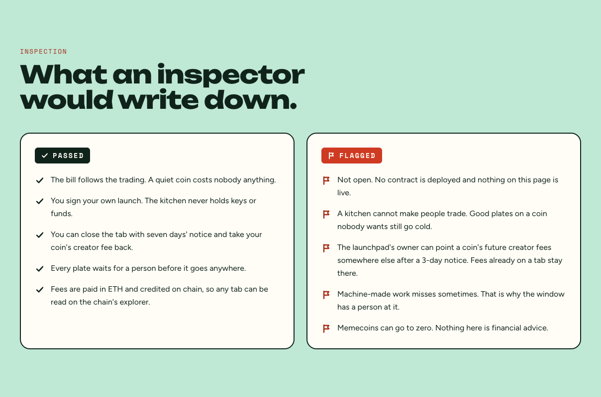

**What the app never asks for**

- A seed phrase or a private key. The chef signs with their own wallet, like any other dapp.
- A login to the chef's social accounts. Plates are handed over by copy and download.
- Approval to move the chef's tokens. The only transaction is the one that opens the coin, and later a withdrawal or a close.

**What the contracts guarantee**

- **No lock-in.** A chef can close the tab with 7 days' notice and take the creator fee back, along with the brand sheet and house page.
- **Timelocked settings.** The Kitchen's owner is a multisig, and changes to terms, keeper or Stove wait 3 days and apply only to coins opened afterwards.
- **A capped keeper.** The only key the kitchen holds can claim, bill, burn in capped batches and pause a daily special. Nothing more.
- **Burn, never lock.** The launchpad's own buyback locks tokens for years. Kitchen coins launch with it switched off.

**What we flag ourselves**

- The launchpad's owner can point a coin's future creator fees elsewhere after a 3-day notice, and a Tab can't veto it. The kitchen watches for it, shows the notice at the window, finishes what is billed and starts nothing new.
- A kitchen cannot make people trade. Good plates on a coin nobody wants still go cold.
- Machine-made work misses sometimes. That is why the window has a person at it.

---

## Roadmap

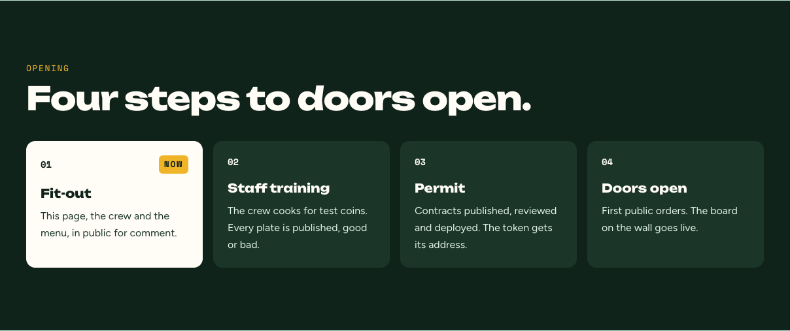

| Phase | What happens | What it proves |
|---|---|---|
| **1. Fit-out and staff training** (now) | The page, the crew and the menu in public. The crew cooks for test coins and every plate is published, good or bad | The crew can cook plates people would serve |
| **2. Permit and doors open** | Contracts reviewed, deployed and published with their source. $COOK opens. First public orders, the board goes live, the first burn batch inside day one | Tabs fill, bills follow, burns land on chain |
| **3. Regulars** | Service tiers, rush orders, bring your own coin, evening plates, weekly brand refreshes | Chefs come back, and $COOK has a job they use |
| **4. More kitchens** | Private kitchens for communities and launch teams, a station API priced in ETH, new stations picked by the Chef's Table | Other teams want a kitchen of their own |

---

## Under the hood

| Layer | What it is |
|---|---|
| **Contracts** | Solidity on Robinhood Chain (EVM, chainId 4663): Kitchen, Tab (one per coin, deployed with CREATE2), Burner, plus the Stove treasury. Tested with Foundry on a fork of the chain |
| **App** | Next.js and React with standard EVM wallets. Chef endpoints need a signed message from the wallet that opened the coin |
| **Crew** | A Node.js worker: the kitchen queue, seven stations behind one internal interface over a multi-model AI stack, and Expo's checks. Every job logs its cost and its result |
| **Keeper and indexer** | Claims every tab daily, bills unlocked items, fires capped burn batches, and watches the launchpad for fee-route notices |
| **Data** | Encrypted Postgres with row-level security forced on every table, plus private object storage for images. Money figures are never stored: pages read them from the chain |

---

## Brand

  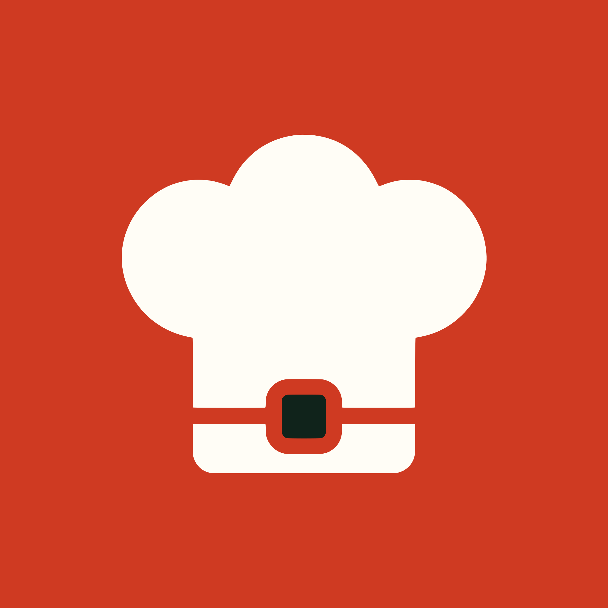

  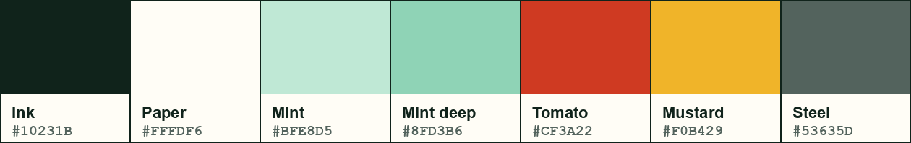

A mint diner kitchen in service. The logo is a chef's hat with a belt and a square buckle, paper on tomato. Type: **Unbounded** for display, **Figtree** for text, **Space Mono** for figures.

House line: ***Let them cook.***

---

## Disclaimer

Cook Agents is a community project. It is not affiliated with, endorsed by or sponsored by Robinhood, Robinhood Chain or any launchpad.

Nothing here is financial advice or an offer of any security. $COOK carries no claim on fees, no staking and no payouts. Memecoins are risky and can lose all their value. Launchpad figures were read from the chain on 13 October 2026; they belong to the launchpad and can change. Prices, splits and tiers are proposals until the contracts are published. Machine-made work can be wrong: every plate waits for a person, and the chef decides what is served.

   
  
   
  <a href="https://cookagents.fun">cookagents.fun</a> · <a href="https://cookagents.fun/docs">docs</a> · <a href="https://x.com/cookagents">@cookagents</a>

